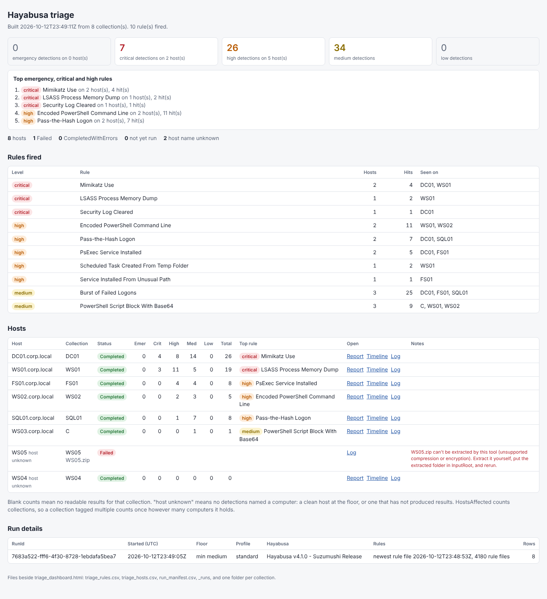
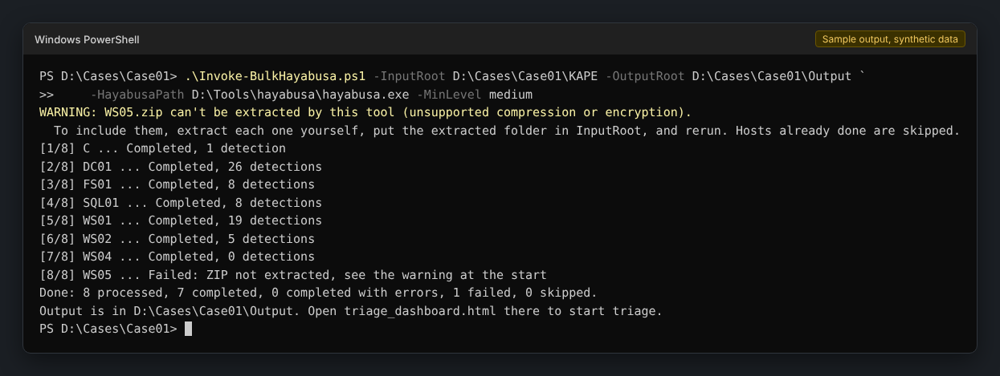

# Hayabusa-Bulk-Runner

A PowerShell wrapper that runs [Hayabusa](https://github.com/Yamato-Security/hayabusa) across a folder of KAPE collections, one run per host, and rolls the results up into a single cross-host triage view.

Hayabusa already takes a whole directory with `-d`, and its HTML summary breaks the results down by computer. A folder of KAPE collections still leaves two jobs to do by hand. Each ZIP has to be extracted and each disk image mounted before Hayabusa can read it, and a run over all of them gives one combined output, with no report or timeline of its own for each host. This does that part. Point it at a folder with one entry per host and you get, for each host, Hayabusa's HTML alert report, a CSV timeline and a log, plus a dashboard showing which hosts are worst and which rules fired where.

## Status

Pre-release. It's been run against real Hayabusa 4.1.0 and real KAPE images and ZIPs on Windows, and the test suite runs in CI on Windows PowerShell 5.1, PowerShell 7 on Windows, and PowerShell 7 on Linux. Three things still need the right evidence to confirm, listed below.

### Not yet confirmed on Windows

Each of these depends on something the test data didn't have:

- The emergency Level string as Hayabusa writes it in the CSV. None of the test data produced an emergency detection. Both `emer` and `emergency` are accepted until it's seen.
- Volume checks on `\\?\Volume{...}\` paths when an image has more than one volume. Every test image had one.
- The `_mnt` folder fallback, used when Windows gives the mounted image no drive letter: that Hayabusa accepts the folder path as `-d`, and that teardown removes it. Every test image got a letter.

## Requirements

- Windows. This tool runs Hayabusa and mounts disk images on Windows only. The rollup can be rebuilt anywhere PowerShell runs.
- Windows PowerShell 5.1 or PowerShell 7.
- Hayabusa 4.1.0 with its rules. Run `hayabusa.exe update-rules` once at the start of the engagement and leave the rules alone until it's finished, so every host is checked against the same set.
- An elevated session if any collection is a disk image, including a disk image inside a ZIP.

## Getting it

Clone the repository, or download it as a ZIP from GitHub and extract it:

```powershell
git clone https://github.com/rorywag/Hayabusa-Bulk-Runner.git
```

Keep the `lib` folder beside the two scripts, since they load everything from it. Windows marks files from a downloaded ZIP as coming from the internet. The Process-scope execution policy shown below already allows them, so there's nothing to unblock.

## Quick start

```powershell
.\Invoke-BulkHayabusa.ps1 -InputRoot D:\Cases\Case01\KAPE -OutputRoot D:\Cases\Case01\Output -HayabusaPath D:\Tools\hayabusa\hayabusa.exe
```

It prints one line per host as it goes, then a short summary and where to look:

```
[1/4] DC01 ... Completed, 12 detections
[2/4] FS02 ... Completed, 6 detections
WARNING: [3/4] WS03 ... Failed: Hayabusa exited with code 2. See D:\Cases\Case01\Output\WS03\WS03_hayabusa.log. No CSV was written.
[4/4] WS04 ... skipped, already Completed
Done: 3 processed, 2 completed, 0 completed with errors, 1 failed, 1 skipped.
Output is in D:\Cases\Case01\Output. Open triage_dashboard.html there to start triage.
```

Add `-Verbose` for more detail. `-InformationAction SilentlyContinue` hides the progress lines and leaves only warnings.

In a fresh PowerShell window the script may be blocked by the execution policy. This allows it for that window only, and changes nothing on the machine:

```powershell
Set-ExecutionPolicy -Scope Process -ExecutionPolicy Bypass
```

With an engagement config and a lower severity floor:

```powershell
.\Invoke-BulkHayabusa.ps1 -InputRoot D:\Cases\Case01\KAPE -OutputRoot D:\Cases\Case01\Output `
    -HayabusaPath D:\Tools\hayabusa\hayabusa.exe -ConfigPath D:\Cases\Case01\engagement.psd1 -MinLevel medium
```

### Customising a run

The command line takes InputRoot, OutputRoot, HayabusaPath, MinLevel, Threads, Force, KeepArtifacts and ConfigPath. Everything else goes in the [engagement config](#engagement-config): ExactLevel, IncludeTags or ExcludeTags, a time window, the output profile, a custom rules path and the ZIP limits. MinLevel is the only setting that can go in both, and the command line wins. The tool exposes this fixed set on purpose and leaves everything else at Hayabusa's defaults.

Each of these is a complete command. Copy one and change the paths:

```powershell
# Default triage run, floor at high. Start here on a new case.
.\Invoke-BulkHayabusa.ps1 -InputRoot D:\Cases\Case01\KAPE -OutputRoot D:\Cases\Case01\Output -HayabusaPath D:\Tools\hayabusa\hayabusa.exe

# Broader sweep, medium and up, when high is too narrow.
.\Invoke-BulkHayabusa.ps1 -InputRoot D:\Cases\Case01\KAPE -OutputRoot D:\Cases\Case01\Output -HayabusaPath D:\Tools\hayabusa\hayabusa.exe -MinLevel medium

# Cap Hayabusa at two threads, on a box that's busy with other work.
.\Invoke-BulkHayabusa.ps1 -InputRoot D:\Cases\Case01\KAPE -OutputRoot D:\Cases\Case01\Output -HayabusaPath D:\Tools\hayabusa\hayabusa.exe -Threads 2

# Rerun every host, finished ones included, after fixing something such as the rules.
.\Invoke-BulkHayabusa.ps1 -InputRoot D:\Cases\Case01\KAPE -OutputRoot D:\Cases\Case01\Output -HayabusaPath D:\Tools\hayabusa\hayabusa.exe -Force

# Keep extracted ZIPs and differencing disks, to debug a host that failed.
.\Invoke-BulkHayabusa.ps1 -InputRoot D:\Cases\Case01\KAPE -OutputRoot D:\Cases\Case01\Output -HayabusaPath D:\Tools\hayabusa\hayabusa.exe -KeepArtifacts

# Engagement settings from a config: ExactLevel, tag filters, a time window and the output profile live there.
.\Invoke-BulkHayabusa.ps1 -InputRoot D:\Cases\Case01\KAPE -OutputRoot D:\Cases\Case01\Output -HayabusaPath D:\Tools\hayabusa\hayabusa.exe -ConfigPath D:\Cases\Case01\engagement.psd1
```

`-MinLevel` takes any of the six levels, informational, low, medium, high (the default), critical or emergency, and means that level and up.

A rerun skips hosts that already finished, whatever the settings. On a case that's already been run, add `-Force` so a new floor or config applies to those hosts too.

`Get-Help .\Invoke-BulkHayabusa.ps1 -Full` lists every parameter.

| Parameter | What it does |
|---|---|
| `-InputRoot` | Parent folder holding one entry per host |
| `-OutputRoot` | Where everything is written. Created if missing. Must not be inside InputRoot |
| `-HayabusaPath` | Full path to `hayabusa.exe` |
| `-MinLevel` | Severity floor: informational, low, medium, high, critical or emergency. Default high |
| `-Threads` | Passed to Hayabusa. Leave it out to let Hayabusa decide |
| `-Force` | Rerun hosts that already finished |
| `-KeepArtifacts` | Keep extracted ZIPs and differencing disks after each host, for debugging |
| `-ConfigPath` | Engagement config file, see below |

### Lay out each case the same way

Give each case one folder, and keep its OutputRoot in the same place for the life of the case:

```
D:\Cases\Case01\
  KAPE\              InputRoot: one entry per host
  Output\            OutputRoot: every run for this case goes here
  engagement.psd1    the case's config, if it has one
```

Always rerun into the same OutputRoot. Its manifest is what a rerun resumes from, as [Rerunning and resuming](#rerunning-and-resuming) explains, and pointing a rerun at a new folder starts the whole case from scratch.

## Screenshots

The dashboard after a run over eight hosts, with the severity floor at medium:



*Synthetic sample data. Every host, rule and detection in it is made up.*

The console during the same run:



*Progress lines and the end-of-run summary from the same run.*

## Input model

Each top-level entry in InputRoot is one collection, normally one host:

- a folder: KAPE's loose output, used as is
- a `.vhdx` or `.vhd`: a KAPE container image, mounted for the run
- a `.zip`: extracted to a working folder. If it holds one disk image, that image is mounted. A ZIP holding two or more disk images is warned about at the start and fails. Otherwise the extracted folder is used as loose output

Hayabusa recurses, so it doesn't matter how deep the logs are inside each entry.

Everything else is skipped: KAPE's own `_ConsoleLog.txt`, `_CopyLog.csv` and `_SkipLog.csv` quietly, any other loose file with a warning. Links and junctions are skipped too, since they could point outside InputRoot, and so are `$RECYCLE.BIN` and `System Volume Information` when InputRoot is a drive root.

Each entry gets a collection name, used for its output folder: the entry name without the container extension, with anything outside `A-Z a-z 0-9 . _ -` replaced by `_`. Two entries that end up with the same name, say `HOST01` and `host01.zip`, stop the run before anything is written, and you rename one.

The collection name isn't the host name: KAPE often names loose output after the drive, so the folder is just `C`. The Host column comes from the `Computer` field in Hayabusa's results instead. A collection with more than one `Computer` value is covered under [Outputs](#outputs). A host with no detections at the floor has nothing to take a name from: `triage_hosts.csv` shows it as `[unknown]`, the dashboard tags it "host unknown", and the manifest leaves its Host blank.

Things that trip people up, and get a warning:

- InputRoot pointed at one host's volume root, so Windows, Users and the rest would each become a "host"
- a disk image sitting inside a loose folder. It won't be mounted there. Put the image directly in InputRoot
- a ZIP holding a disk image and loose event logs as well. The image is processed and the loose logs are skipped
- a ZIP inside a ZIP. Only one level is opened

## ZIPs: extract them first if the tool says so

The ZIP reader in .NET only handles the two common compression methods, Stored and Deflate, and no encryption. A ZIP made with Deflate64, BZip2, LZMA, Zstandard, XZ or PPMd, or with a password, can't be extracted by this tool.

Every ZIP is checked when InputRoot is read, before anything runs. Each one that can't be extracted gets one short warning at the start of the run, followed by what to do:

```
WARNING: HOST07.zip can't be extracted by this tool (unsupported compression or encryption).
  To include them, extract each one yourself, put the extracted folder in InputRoot, and rerun. Hosts already done are skipped.
```

The host is marked Failed. The manifest and dashboard carry the same one-line message, and the technical detail, such as which entry uses which compression method, goes in that host's `HOST07_hayabusa.log`, linked from the dashboard.

The fix is to extract the ZIP with 7-Zip or similar, put the extracted folder in InputRoot in place of the ZIP, and rerun. If the ZIP held a disk image, put the `.vhdx` or `.vhd` itself directly in InputRoot, not the folder around it, so it gets mounted.

If the check can't make sense of a ZIP at all, or an entry name holds a character no Windows path can use, such as `|` or a control character, it's treated the same way: listed, failed, never half-extracted. A ZIP that can't be read never counts as readable.

ZIPs that can be extracted are still treated as hostile. Before anything is written, every entry name is checked for path traversal and names Windows can't hold, and the declared size and compression ratio are checked against limits. The defaults are 100 GB of uncompressed content and a 250:1 ratio of extracted size to ZIP size. Both are set in the engagement config, as `ZipMaxUncompressedGB` and `ZipMaxRatio`. Extraction counts the bytes actually written, and stops if an entry writes more than it claimed. It also checks there's room for the extract on the OutputRoot volume, and warns if it can't tell, as on some network shares.

Deep paths are fine. KAPE output can run past Windows' 260-character path limit, for example the crash reports under `C\ProgramData\Microsoft\Windows\WER\ReportArchive`. The tool writes, lists and removes the extract through Windows' extended-length paths, so those extract like anything else. If a path still can't be created, that collection fails with a message saying so. For a long path the fix is a shorter OutputRoot, such as `D:\Out`, or extracting the ZIP yourself nearer the drive root. A single name over 255 characters can't be created anywhere on Windows, so extract that ZIP yourself with a tool that can shorten or skip the entry, then apply the same fix as above.

## Disk images and elevation

Mounting a disk image needs an elevated session. If any collection is a disk image, or a ZIP holding one, and the session isn't elevated, the run stops at the start before anything is written and says which collections need it. Rerun from an Administrator PowerShell prompt. A run with only folders and plain ZIPs doesn't need elevation.

The differencing disk is created with diskpart, which can't reliably read non-ASCII characters in a path. A disk image whose path, or whose OutputRoot, holds any is refused with a message saying so, before diskpart runs.

## Evidence integrity

The evidence is only ever read.

- Disk images are never mounted directly. KAPE images are dirty when they're created, so a read-only mount shows no volume at all. Instead the tool mounts a differencing disk under `OutputRoot\_diff` with the evidence image as its parent. Windows replays the journal into the child and the parent is only read, checked on real KAPE output with the parent's hash the same before and after.
- An image that's already attached is refused, not reused or dismounted, since this run didn't attach it.
- ZIPs are extracted to a working copy under `OutputRoot\_work`. The ZIP itself is only read.
- After each host, teardown runs in a fixed order, whatever happened: remove the folder mount point if one was used, dismount the child, remove the empty mount folder, delete the child, delete the extract. Nothing is ever deleted recursively through a folder that might still be a mount point. The tool only deletes inside its own `_work`, `_mnt` and `_diff` folders, plus a host's own previous report and timeline just before that host is rerun. If a dismount fails, everything after it is left in place and the error says what's still there.
- OutputRoot is refused if its path is inside InputRoot, so output doesn't land next to the evidence.
- Nothing from the evidence is ever run. Values from it, such as rule titles and computer names, are encoded wherever they're written out, as [Outputs](#outputs) describes.

## Outputs

Everything lands under OutputRoot:

| Path | What it is |
|---|---|
| `<Collection>\<Collection>_report.html` | Hayabusa's own alert summary for that host |
| `<Collection>\<Collection>_timeline.csv` | Hayabusa's CSV timeline, UTC |
| `<Collection>\<Collection>_hayabusa.log` | The exact arguments, Hayabusa's output and its exit code |
| `run_manifest.csv` | One row per collection with its latest status, counts, warnings and errors |
| `_runs\run_meta_<time>_<RunId>.json` | What each run used: Hayabusa and rules versions, settings and where each came from, config hash, ZIP limits, collections, summary |
| `triage_hosts.csv` | One row per collection, worst first, with counts by level and the top rule |
| `triage_rules.csv` | One row per rule and level, by severity, then how many hosts it fired on |
| `triage_dashboard.html` | The dashboard |

The dashboard is rule-first: a summary of totals by severity and the top rules, then the rule table, then the host table with links to each host's report, timeline and log, then where each row came from. Counts, report and timeline are only shown for a Completed or CompletedWithErrors host. A Failed host's files may be left from an earlier run, so it shows only its error and its log. It's one static file with no script and nothing loaded from the internet. Every value taken from the evidence is HTML-encoded, and a Content Security Policy blocks script outright, so a rule title like `<script>` just shows up as text. Paths are shown relative to OutputRoot, so the dashboard can be shared without giving away the case's folder layout.

A collection whose results name more than one computer is never given just one of them. The manifest marks its host `[multiple]` with a count of each name, and the dashboard and `triage_hosts.csv` show the names as its host, up to three of them and then `+N` for the rest, for example `WS01, WS01.corp.local`. The dashboard tags it "multiple" and its notes list every name with its count. A severity tile with nothing in it is greyed out, so the levels that did fire stand out.

Values a spreadsheet would treat as a formula, anything starting with `=`, `+`, `-`, `@`, a tab or a carriage return, get a leading `'` in the triage CSVs and the manifest, so opening them in Excel can't run anything. The tool strips that `'` again when it reads its own manifest back.

Severity follows Hayabusa's six levels: emergency, critical, high, medium, low, informational. One emergency outranks any number of criticals.

### Working folders

Some folders under OutputRoot belong to the tool:

| Folder | What it's for |
|---|---|
| `_runs` | One provenance record per run, written when the run starts and completed when it ends, and never overwritten by a later run. Together they show what every row in the manifest was produced with |
| `_diff` | The differencing disks a disk image is mounted through. Each one is deleted when its host finishes, unless `-KeepArtifacts` is given, so after a clean run without it this folder is empty. Anything left in it means a teardown didn't finish, and the run's warnings will say which |
| `_work` | Extracted ZIPs, deleted after each host unless `-KeepArtifacts` is given |
| `_mnt` | Empty folders a volume is attached to when Windows gives it no drive letter |

## Rerunning and resuming

The manifest is the record of what's been done. On a rerun, hosts that are Completed or CompletedWithErrors are skipped, and everything else is tried again: Failed, Pending, and anything left Running by a run that was interrupted. `-Force` reruns the lot. Rerunning a host removes its previous report and timeline just before Hayabusa runs, so what's recorded is always that run's own result. So after fixing a problem, say extracting a ZIP the tool couldn't, just run the same command again.

| Status | Meaning |
|---|---|
| Completed | Hayabusa exited cleanly. No detections is still Completed |
| CompletedWithErrors | Hayabusa exited non-zero but still wrote a timeline. Counts are kept and the exit code is in Error |
| Failed | The input couldn't be prepared, Hayabusa wrote nothing, the results couldn't be read, or teardown failed. After a teardown failure, the manifest keeps the counts from a finished Hayabusa run, but the dashboard and triage CSVs leave them out, as they do for every Failed host |
| Pending | Found but not run yet |
| Running | Being run, or the run was interrupted |

One host failing never stops the batch.

To rebuild the triage files and dashboard from an existing OutputRoot without rerunning anything, on any machine:

```powershell
.\Invoke-HayabusaRollup.ps1 -OutputRoot D:\Cases\Case01\Output
```

## Engagement config

Settings that should stay the same for a whole engagement go in a `.psd1` file passed with `-ConfigPath`. Copy [config/engagement.example.psd1](config/engagement.example.psd1), which lists every setting with a comment, and edit it. It can set the rules path, `MinLevel` or `ExactLevel`, Sigma tag filters, a time window, the output profile and the ZIP limits. Use `IncludeTags` or `ExcludeTags`, not both: Hayabusa 4.1.0 won't take the two together, so a config that sets both is refused before anything runs.

`ExactLevel` sets a single level instead of a floor, for example only critical. MinLevel and ExactLevel are mutually exclusive: a config that sets both is refused, and `-MinLevel` on the command line replaces a config's ExactLevel.

`Profile` takes `standard`, the default, or `verbose`. Verbose adds more detail per event to each host's timeline CSV: MITRE tactics and tags, other tags, and the rule and EVTX file names. The tool's counts and rollup only read Level, Computer and RuleTitle, which both profiles include, so the profile changes the per-host detail and never the rollup. Hayabusa's other profiles aren't accepted. The Timesketch ones, for example, rename RuleTitle to `message`, which the rollup can't read.

It's read as data only, so it can't run code. Unknown keys are rejected, so a typo can't silently drop a filter. A setting given on the command line wins over the config, which wins over the default, and run-meta records which one each setting came from. Real configs are git-ignored when they're under `config\` or named `engagement*.psd1` or `*.local.*`, and only the example is tracked. A config with any other name elsewhere in the repo, such as `case01.psd1` at the root, would be tracked, so keep it outside the repo or name it to match.

## Running the tests

The tests use [Pester](https://pester.dev) 5 and a fake Hayabusa written in PowerShell, so they don't need the real binary or any evidence.

```powershell
Install-Module Pester -RequiredVersion 5.7.1 -Scope CurrentUser -Force -SkipPublisherCheck
Invoke-Pester -Path .\tests
```

Most of the suite runs anywhere. The end-to-end run with the fake binary needs Windows. `tests\Mount.Integration.Tests.ps1` builds a small VHDX, mounts it the same way a real run does, and checks the image's hash is unchanged afterwards. It only runs on Windows in an elevated session and skips everywhere else.

Lint with [PSScriptAnalyzer](https://github.com/PowerShell/PSScriptAnalyzer), which includes the Windows PowerShell 5.1 compatibility rules:

```powershell
Install-Module PSScriptAnalyzer -RequiredVersion 1.23.0 -Scope CurrentUser
foreach ($p in '.\Invoke-BulkHayabusa.ps1', '.\Invoke-HayabusaRollup.ps1', '.\lib') {
    Invoke-ScriptAnalyzer -Path $p -Recurse -Settings .\PSScriptAnalyzerSettings.psd1
}
Invoke-ScriptAnalyzer -Path .\tests -Recurse -Settings .\tests\PSScriptAnalyzerSettings.psd1
```

CI runs both, plus gitleaks, on every push and pull request.

## Security

See [SECURITY.md](SECURITY.md) for how to report a vulnerability privately.

## Licence

MIT. See [LICENSE](LICENSE).

This tool is independent and is not affiliated with or endorsed by Yamato Security. It runs Hayabusa as a separate external program and includes none of its code. Hayabusa is published by Yamato Security under the GNU AGPL-3.0, and its detection rules under their own licences. Download Hayabusa and its rules from Yamato Security.
